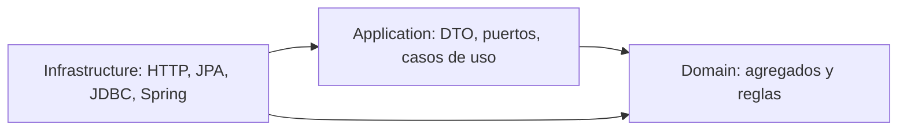

### Petición 10 — Asistente documental con RAG (bloque 75, en curso)

Application declara `AskAssistant`, `IndexDocuments` y puertos puros para embeddings, búsqueda, generación y conversación. Infrastructure adapta Ollama, Gemini y pgvector mediante REST/JDBC. La autorización exige `assistant.query`, filtra repositorios donde el usuario también tiene `document.read` y excluye documentos/versiones archivados o eliminados. Gemini recibe solo los pasajes recuperados; el prompt distingue texto de documentos de instrucciones confiables. Si no existe evidencia recuperada, el caso de uso se abstiene y no llama al LLM.

V29 añade `document_chunk_vectors` con RLS, tipo `vector` flexible y validación de dimensiones. Compose construye pgvector 0.8.7 sobre la misma base `postgres:17.7-alpine`; el build de la imagen aislada pasó, pero la migración sigue sin aplicarse al servicio activo. Backend y frontend compilaron. La solicitud HTTP indexa como máximo 32 chunks por llamada; no hay worker durable ni progreso, ni listado/recarga de conversaciones. Proveedores y flujo autenticado no se han probado en ejecución.

## Bloque 74 — Centro de documentación (petición 9)

Domain valida `DocumentName` y tipos admitidos; Application define `ManageDocuments`, sus DTO/puerto/caso de uso y límites independientes de Spring. Infrastructure ofrece `DocumentCenterController`, `JdbcDocumentLibrary` y el wiring del caso de uso. Los originales se guardan fuera de la webroot bajo `APP_DOCUMENTS_STORAGE_ROOT`, en volumen privado, con clave generada por UUID y SHA-256; la UI no recibe rutas internas. La autorización exige `document.read` o `document.manage`, limita las asociaciones a repositorios accesibles y hace cumplir el RLS/contexto tenant. Listados/búsquedas filtran los nombres de repositorio por el mismo alcance.

Tika 4.2.0 se ejecuta con `PipesForkParser` y un proceso JVM hijo (1 proceso, heap 256 MiB, 45 s). Se admiten 50 MiB por archivo, máximo 500 páginas PDF y 1 M de caracteres indexados. El texto se guarda en `document_chunks` y se busca mediante el GIN `to_tsvector` existente; no se llama a Gemini/Ollama ni se guardan vectores. Versiones y procesamiento usan `document_versions`/`document_processing_runs`; borrado marca la solicitud V9 como pendiente, retira el original y limpia chunks/evidencias/metadatos antes de completarla.

No se añade migración. La cobertura no incluye asociación a componentes/versiones, OCR, aplicación automática de retención, ni indexación semántica; el recorrido HTTP de usuario permanece pendiente del bootstrap que necesita Compose.
## Bloque 73 — petición 8: consulta de historial y fallos de análisis (23/11/2026)

La pantalla Análisis solicita `POST /api/organizations/{organizationId}/repositories/{repositoryId}/dependency-analysis`; comparte el flujo que genera snapshots Maven y npm y después pide la evaluación OSV por separado. `GET /api/organizations/{organizationId}/repositories/{repositoryId}/scans` requiere `scan.read`, limita la consulta al repositorio/organización, aplica contexto tenant/RLS y devuelve hasta 50 ejecuciones con commit, estado, scanner, conteos, cobertura, error y hash de fuente. Application define `FindScanHistory` y `ScanHistoryReader`; Infrastructure implementa PostgreSQL/JDBC.

Los fallos de lectura dentro de Maven/npm se insertan como scans `FAILED`, con scanner/ecosistema, commit o hash local y motivo, conservando los snapshots completados anteriores. No se añadió migración (V28 conserva las columnas necesarias). La operación de análisis sigue síncrona; no se usa el endpoint `POST /scans`, cuyo job todavía carece de worker. Fallos previos a la apertura de una fuente no tienen un commit/hash confiable para persistir.

## Bloque 66 — consulta del catálogo de Inventario

Application autoriza el conjunto de repositorios mediante `FindAccountWorkspace` y delega la lectura a `InventoryCatalogReader`. Infrastructure aplica RLS en `TenantTransactions` y usa consultas acotadas para snapshots, apariciones y evidencia OSV. `GET /api/organizations/{organizationId}/inventory` agrega las apariciones filtradas y entrega una página de paquetes. `GET /api/organizations/{organizationId}/inventory/occurrences` devuelve las apariciones de un paquete exacto con los mismos filtros. El esquema permanece en V26.

## Bloque 65 — una fuente por análisis y evaluación OSV por scan

El caso de uso de Application abre una fuente a través de `RepositoryAnalysisSource` y entrega la misma instantánea a ambos lectores. Infrastructure compara CycloneDX con POM y lockfiles estáticos. Si falta un manifiesto se registra la ausencia para que una recarga no muestre un inventario de una fuente anterior como vigente. Los resultados y errores de cada ecosistema se entregan por separado. V26 guarda la ruta del manifiesto y mantiene la lectura de las ocurrencias históricas.

OSV conserva sus adaptadores y las consultas se pueden repetir con los IDs de scan que muestra Inventario. El filtro SQL aplica organización, repositorio, scanner compatible y estado completado. Los endpoints individuales y las consultas OSV sin IDs siguen disponibles para los flujos existentes.

## Actualización — scanner Maven y presentación de Inventario (22/11/2026)

Infrastructure incorpora `MavenPomDependencyResolver`, usado como fallback del puerto de lectura Maven solo cuando cdxgen detecta manifiestos pero no componentes. Trabaja sobre POM acotados extraídos del ZIP autorizado y resuelve herencia y gestión local de versiones/BOM sin ejecutar procesos externos. Domain y Application no adquieren dependencias de Spring ni del parser. Las declaraciones se persisten con el flujo existente y OSV continúa como etapa separada basada en versiones exactas. La interfaz presenta resultados por ecosistema y detalle progresivo de cobertura, más búsqueda/filtros del inventario. El runtime real requiere un nuevo análisis autenticado de OMEGA para confirmar la recuperación en datos de usuario.

# Arquitectura del backend

## Bloque 58 — fallback para inventario Maven sin SBOM

`CdxgenMavenManifestReader` conserva el ZIP autorizado en un temporal limitado y usa `BoundedMavenArchiveReader` si cdxgen informa POM pero no componentes. El fallback solo guarda coordenadas con versiones exactas observadas en POM/propiedades locales, no inventa transitivas, y marca cobertura parcial. Luego OSV evalúa las versiones persistidas por el flujo independiente `VulnerabilityAssessmentController`; la evidencia queda asociada a cada scan y componente.
## Bloque 56 — Inventario y evaluación OSV independientes

Los endpoints `POST /maven-analysis` y `POST /npm-analysis` generan CycloneDX con cdxgen y persisten scans, componentes y clasificaciones respaldadas por la fuente. OSV no ejecuta ese scanner: `POST/GET /vulnerability-analysis` lee el último scan completado por ecosistema (`cdxgen-*` o los nombres legacy), consulta versiones exactas y persiste los resultados vinculados a `scan_component_id`. Una respuesta OSV fallida no borra ni revierte el inventario; queda indicada como `UNAVAILABLE`/`INCOMPLETE` y la UI permite volver a consultar OSV sin repetir cdxgen.

Cuando cdxgen detecta `package-lock.json` pero emite cero componentes, el lector npm reabre el archivo con el parser de lockfile ya existente; el resultado recuperado queda con cobertura parcial y procedencia clara. Los archives se reproducen desde un temporal limitado a 100 MiB, borrado al terminar. No se lanzan npm ni scripts del proyecto. Ver [guía del scanner](../infra/scanner/README.md), [pendientes](PENDIENTES.md) y [bitácora](BITACORA_TRABAJO.md).


## Bloque 44 — evidencia estática de código y repositorios

Application incorpora `FindRepositoryVulnerabilityEvidenceUseCase` detrás de `FindRepositoryVulnerabilityEvidence` y `RepositoryCodeArchive`. El caso de uso lee el ZIP como stream sin extraerlo, acepta Java/Kotlin/Groovy/Scala y limita la entrada expandida a 128 MiB, 10.000 entradas, 1 MiB por archivo y ocho coincidencias. Para dos IDs GHSA conocidos busca patrones del aviso y devuelve ruta, línea, extracto y motivo, con hash SHA-256/commit/proveedor del snapshot. No sigue datos entre métodos o archivos y sus resultados son pistas de revisión, nunca un veredicto de explotación. El controlador comprueba `repository.read` en contexto tenant antes de solicitar/leer el snapshot. No se persiste código ni se añade migración.

`DeleteRepositoryUseCase` deshabilita el registro para conservar scans e historial; el adaptador elimina además ZIP y metadatos de fuente local. La sincronización de GitHub compara cada instalación con los repositorios autorizados, deshabilita los retirados y deshabilita los vinculados cuando una instalación se clasifica REVOKED. Se ejecuta al cargar o sincronizar el espacio; no hay webhooks ni tarea periódica. HTTP DELETE requiere `repository.manage`. Fuentes y descargas ya no consideran repositorios deshabilitados.

## Bloque 43 — presentación del resultado OSV

Dashboard consulta el endpoint de evaluación existente para cada repositorio al que tiene acceso y combina resultados Maven/npm con los snapshots de vulnerabilidades. La clasificación de presentación usa la severidad de OSV: CRITICAL, HIGH y MEDIUM/LOW/UNKNOWN como advertencia; «sin avisos conocidos» solo se asigna al estado `NO_KNOWN_ADVISORIES`. `INCOMPLETE`, `UNAVAILABLE`, `STALE` y `NOT_ASSESSED` se contabilizan como pendientes. Si hay varias alertas para la misma versión, el resumen usa la de mayor severidad. No hay cambios a Domain, Application, Infrastructure, contratos, permisos o base de datos.

## Bootstrap del primer administrador de plataforma

El caso de uso `BootstrapPlatformAdministrator` vive en Application y depende de puertos propios para hash de contraseña y persistencia. Infrastructure aporta el adaptador JDBC transaccional y el comando de consola bajo el perfil exclusivo `platform-admin-bootstrap`. Compose lo expone como servicio opt-in `platform-admin-bootstrap`, sin puertos HTTP; solicita los datos en una terminal con eco de contraseña desactivado y requiere confirmación literal. Un bloqueo advisory y una verificación dentro de la transacción exigen cero usuarios, organizaciones y administradores antes de crear una cuenta OWNER aprobada/verificada, su credencial PBKDF2, su rol global y el evento de auditoría. No existe endpoint ni bootstrap automático en el backend normal; el procedimiento se limita a una base local nueva. Ver [acceso local](ACCESO_LOCAL.md).

## Decisión de admisión por correo

Bloque 20: Application contiene el caso de uso `DecidePlatformAdmission` y sus puertos; Infrastructure adapta SMTP, HTTP y persistencia JDBC. Cada token está dirigido a un administrador y a una cuenta pendiente. La ruta procesa la decisión inmediata sin sesión, con consumo único y trazabilidad de auditoría. La pantalla persistente de espera pertenece al flujo de acceso y permanece independiente del token. Configuración y limitaciones en [Verificación y recuperación](VERIFICACION_Y_RECUPERACION.md).

## GitHub App para repositorios

Application declara `ManageGitHubInstallation`, `GitHubAppGateway`, `GitHubInstallationStore` y `GitHubInstallationStateStore`; el caso de uso puro valida sesión/organización, expiración, consumo único de `state`, PKCE, pertenencia del usuario GitHub a la instalación y límites de la selección. Infrastructure implementa la REST API, JWT de aplicación, intercambio del código, almacenamiento temporal de estado y adaptadores JDBC. HTTP/controller valida/authz; Angular únicamente dirige el flujo y presenta repositorios. Los tokens de usuario e instalación no se guardan en Domain/Application ni en la base.

El callback autenticado valida la instalación contra un token GitHub de usuario de corta vida y luego confirma el App ID con JWT de la App; el token de usuario se descarta. Esto sigue la advertencia de GitHub de no confiar solo en `installation_id` devuelto por Setup URL. Estado atado a usuario/sesión/organización vence a los diez minutos; el almacenamiento del estado es en memoria, así que reiniciar backend invalida un flujo en curso. Una instalación ya existente puede iniciar directamente OAuth/PKCE tras validar su ID con la App; el consentimiento final valida el acceso del usuario. Solo se persisten instalaciones y metadatos de repositorio seleccionados. Sin esquema/migración nuevo. Configuración, permisos read-only y callbacks en [GITHUB_REPOSITORIOS](GITHUB_REPOSITORIOS.md).

Cuando la App informa una sola instalación disponible que aún no está conectada a la organización, `begin` dirige el botón principal directamente a OAuth/PKCE. Esta detección se hace en backend y no expone a la interfaz las cuentas de otras instalaciones; el callback valida acceso del usuario antes de guardar. Con cero o varias instalaciones se conserva la selección en GitHub o el enlace por ID explícito.

### Importación local de carpetas

`ImportLocalFolderUseCase` valida nombre, límites y rutas en Application. El adaptador HTTP recibe partes multipart y `LocalRepositorySourceStore` guarda un ZIP privado y sus metadatos con SHA-256 en `local_repository_sources` bajo RLS. Compose monta `repository_data` separado de PostgreSQL. Los permisos aplican a ambas fuentes. El límite vigente es 300 MiB de contenido y 50.000 archivos, con hasta 100.001 partes y 512 MiB de cuerpo multipart. `RepositorySourceService` entrega una fuente de lectura con hash y commit de GitHub cuando corresponde.

## Administración de un repositorio por un miembro

V17 agrega `member_repository_permissions` para grants directos por miembro/repositorio. Application valida el catálogo y el estado activo; Infrastructure escribe bajo transacción tenant, FORCE RLS y auditoría. La autorización acepta grant de equipo o grant directo, siempre intersecado con `role_permissions`. Retirar una membresía limpia sus grants. V16/V17 aplicadas a PostgreSQL local; la prueba focalizada de integración de permisos pasó.

V16 añade `repository.manage` a los permisos base de MEMBER, pero su concesión efectiva exige membresía activa, pertenencia al equipo autorizado y grant explícito para el repositorio. Para una comprobación con `repositoryId=null` (acciones organizacionales) la consulta solo permite OWNER/ADMIN, por lo que no se convierte en administrador global. La UI invita como MEMBER al equipo/repositorio y el propietario concede `repository.manage` en la pestaña Permisos. ADMIN conserva alcance organizacional.

## Vulnerabilidades por versión — bloque 42

Application define `AssessRepositoryVulnerabilities`, los DTO internos y el puerto `OsvVulnerabilityGateway`; Domain contiene solo el estado de evaluación. Infrastructure adapta OSV mediante consultas versionadas por lotes y obtiene detalles de avisos por su identificador. El adaptador PostgreSQL escribe snapshots tenant-scoped en V22 con evidencia JSON/hash y estados distintos para hallazgos, respuesta sin avisos, incompletitud y fallo; V23 limita el rol runtime a inserción/lectura append-only. La API autoriza el repositorio antes de invocar el caso de uso; la red OSV se consulta fuera de esa transacción. Angular carga la evidencia vigente y puede solicitar otra evaluación desde Inventario. OSV no escribe el catálogo público ni resuelve rangos por heurísticas propias. Contratos y límites en [OSV_VULNERABILIDADES](OSV_VULNERABILIDADES.md).

## Referencias vigentes y objetivo

Bloque 13 (16/11/2026): rediseño Angular de acceso, shell/dashboard y organización. Reutiliza las APIs existentes; no modifica Domain/Application/Infrastructure del backend ni esquema/migraciones. Estados vacíos para módulos pendientes, sin métricas simuladas. Componentes y revisión en [DISENO_FRONTEND](DISENO_FRONTEND.md).

El objetivo es el producto completo listo para usar por fases, local primero y servidor después. El plan anterior de demo/50 horas deja de limitar la arquitectura o aceptación. Priorizar [contexto maestro](DEPENDENCY_INTELLIGENCE_CONTEXTO_MAESTRO.md), este documento, [diseño database](CODEX_DATABASE_DEPENDENCY_INTELLIGENCE.md) y [stack](STACK_TECNOLOGICO_DEPENDENCY_INTELLIGENCE.md).

Las decisiones confirmadas incluyen acceso local/Google/GitHub, Maven/npm, equipos/permisos por repositorio y pruebas aisladas/propuesta de PR para el primer piloto. IA del producto: Gemini; embeddings: Ollama. Codex no se integra ni se agenda como proveedor hasta nueva instrucción del usuario.

Los módulos describen código existente. Database alcanza V23: 128 tablas de negocio, 91 con FORCE RLS y 227 FK. El flujo local guarda la carpeta en un ZIP privado, ligado a un repositorio local y autorizado por `repository.manage`; el acceso de equipo/miembro a ese repo usa la autorización existente. OSV añade snapshots por versión en V22 y los mantiene append-only en V23. Estado en [implementation-report](database/implementation-report.md).

### Integraciones que se deben separar

- Identidad local y externa detrás de puertos propios: correo/contraseña y vínculos Google/GitHub. La vinculación exige prueba de identidad; no se fusionan cuentas por compartir correo, incluso si está verificado.
- Login GitHub e instalación/autorización para repositorios son flujos de identidad y acceso distintos, aunque una GitHub App puede participar en ambos. Elegir el registro concreto durante implementación; no asumir que hacen falta dos aplicaciones externas.
- Puertos de generación/embeddings: adaptadores Gemini y Ollama en Infrastructure; modelos/dimensión y cuotas comprobados antes de configurar vectores. No son dependencias del dominio ni servicios implementados todavía.
- Almacenamiento privado de originales/artefactos mediante un puerto: descarga/reindexación autorizadas, temporales separados y eliminación/retención configurables. No se elige ni contrata un proveedor de almacenamiento en este bloque.
- Pruebas de cambios en ejecución aislada; propuesta de PR y acciones sobre repositorios sujetas a aprobación explícita en el flujo, sin modificar ramas principales automáticamente.

Referencia sobre identidad e instalaciones: [documentación oficial de GitHub Apps](https://docs.github.com/en/apps/creating-github-apps/about-creating-github-apps/about-creating-github-apps).

El backend es un monolito con tres módulos Maven. Importar `backend/pom.xml` en Java Projects o en el IDE: aparecen **Domain**, **Application** e **Infrastructure**. Las carpetas usan minúsculas por convención; los nombres de proyecto están definidos en cada POM.

```text
backend/
  pom.xml                         # Agregador, sin código ejecutable
  domain/                         # Java puro: entidades, agregados, value objects
    src/main/java/com/dependencyintelligence/<contexto>/domain/
  application/                    # Java puro: orquestación y contratos
    src/main/java/com/dependencyintelligence/<contexto>/application/
      dto/                        # Comandos y resultados de casos de uso
      port/in/                    # Interfaces de entrada
      port/out/                   # Contratos que implementan adaptadores
      usecase/                    # Implementaciones de entrada
      exception/                  # Errores propios de aplicación
  infrastructure/                 # Único módulo ejecutable Spring Boot
    src/main/java/com/dependencyintelligence/
      <contexto>/api/              # Adaptadores HTTP y DTO de transporte
      <contexto>/infrastructure/persistence/
      shared/infrastructure/      # Configuración, transacciones, seguridad, errores HTTP
    src/main/resources/db/migration/
```



Las flechas representan dependencias de código. Domain no depende de frameworks. Application solo depende de Domain. Infrastructure implementa los puertos de salida y configura los casos de uso mediante inyección por constructor. Maven impide importar Infrastructure desde Application o Domain con el classpath actual. Las pruebas ArchUnit verifican además los límites del dominio y de aplicación y la ubicación de controladores y entidades JPA.

Los contextos de negocio (`repository`, `scan`, `organization`, etc.) se conservan dentro de cada capa. `shared` contiene únicamente contratos realmente compartidos. Los `package-info.java` de contextos todavía pendientes no representan funcionalidades implementadas.

## Flujo implementado

1. El controlador convierte el DTO HTTP validado a un comando de Application.
2. `RegisterRepositoryUseCase` verifica que exista la organización, construye el agregado y utiliza `RepositoryStore`.
3. `JpaRepositoryAdapter` transforma entre el dominio y `RepositoryEntity`; la restricción SQL resuelve duplicados incluso con solicitudes concurrentes.
4. `FindRepositoryUseCase` siempre consulta por organización e identificador.
5. `RequestScanUseCase` verifica el repositorio dentro de la organización y persiste un análisis `PENDING` mediante `ScanStore`.


`UseCaseConfiguration` es la raíz de composición. Allí se inyecta `Clock`; `TenantTransactions` delimita lecturas/escrituras y establece `app.organization_id` local a la transacción, sin anotar Application con Spring. JPA y JDBC parametrizado comparten datasource y gestor. Impide cambiar de tenant dentro de una transacción activa y el contexto se limpia por commit/rollback. No se crea una entidad ORM para cada tabla sin un caso de uso que la necesite.

Flyway usa credenciales distintas al datasource `dependency_app`, miembro del capability NOLOGIN `dependency_runtime`. `RuntimeDatabaseRoleGuard` rechaza privilegios de propietario, DDL, mantenimiento o BYPASSRLS. El aprovisionamiento del login es administrativo e idempotente. Las tablas tenant tienen ENABLE/FORCE RLS y FK compuestas; catálogos públicos de lectura y auditoría INSERT/SELECT para runtime. Identidades globales requieren controles de autenticación propios. Las credenciales runtime permiten establecer contexto tenant: el backend debe obtenerlo de una operación autorizada, no confiar en una URL ni exponer SQL arbitrario. Ver [operación de base](database/README.md).

## Seguridad y alcance

### Lectura de SBOM implementada — F03

`SbomParser` es un puerto de salida de Application. `CycloneDxJsonParser`, ubicado en Infrastructure, implementa el subconjunto CycloneDX JSON 1.6/Maven acordado para la demo mediante Jackson, ya incluido por Spring Web. No se ha añadido SDK de scanner ni biblioteca nueva.

El resultado usa DTO propios (`ParsedSbom`, `SbomComponent`) y el value object de Domain `PackageCoordinates`. El paquete/versionado se distingue de la ocurrencia identificada por `bom-ref`: dos referencias distintas pueden apuntar al mismo PURL. El componente raíz de `metadata.component` no se incorpora como biblioteca. No se infieren tipo de dependencia, commit ni hallazgos.

Límites de aplicación: 5 MiB y 500 componentes. El adaptador limita lectura, profundidad JSON, longitud de cadenas y números; rechaza claves JSON repetidas, documentos concatenados, referencias duplicadas —incluida la raíz—, campos obligatorios ausentes, versiones no soportadas y PURL incompatibles con las coordenadas declaradas. Los errores usan razones propias de Application, sin exponer excepciones Jackson como contrato.

Es un parser acotado, no un validador completo del estándar. Por ahora solo admite bibliotecas planas y PURL Maven simples que coincidan literalmente con grupo/nombre/versión; no admite qualifiers, subpaths, coordenadas codificadas ni componentes anidados. No sigue URLs ni ejecuta procesos. El puerto recibe un stream propiedad del llamador y no lo cierra. Ya está conectado al caso de uso de importación persistente F04; la carga HTTP y consulta de inventario siguen pendientes.

Las pruebas focalizadas de este bloque son `CycloneDxJsonParserTest` y `HexagonalArchitectureTest`. No necesitan PostgreSQL ni levantar Spring.

### Importación persistente implementada — F04

`ImportSbom` recibe un comando con organización, repositorio y stream. `ImportSbomUseCase` verifica primero el repositorio dentro de la organización, lee mediante `SbomParser` y calcula SHA-256 sobre los bytes originales con `DigestInputStream`. Solo después de validar llama a `SbomImportStore`. El llamador conserva la propiedad del stream.

`UseCaseConfiguration` envuelve el caso de uso en una transacción. `JdbcSbomImportAdapter` exige esa transacción y guarda snapshot, procedencia, catálogo y ocurrencias mediante JDBC parametrizado. Un error revierte todo el bloque; no deja un snapshot fallido ni componentes parciales. La verificación de organización es de coherencia; la futura entrada HTTP deberá aplicar además los controles de acceso correspondientes.

V3 introdujo namespace, origen y `sbom_imports`; V4–V11 conservan esa información en catálogo normalizado y `sbom_documents`. Una importación crea snapshot `COMPLETED`, origen `SBOM_IMPORT`, trigger `IMPORT`, sin referencia Git ni scanner. Sus tiempos son de importación, no ejecución medida. Los análisis normales conservan origen `REPOSITORY_SCAN` y referencia Git obligatoria; los commits observados tienen entidad propia y FK al repositorio.


`sbom_documents` conserva formato, versión de especificación, serial cuando existe y SHA-256. El importador aún no retiene el original; el esquema admite asociar un artefacto privado cuando se implemente almacenamiento. El hash no reconstruye el archivo. F04 se verifica con ImportSbomUseCaseTest, SbomImportIT y RuntimeDatabaseIT; transición y reglas del modelo mediante DatabaseIT/NormalizedSchemaIT. Resultado y entorno exactos en el informe.

### Acceso a la aplicación

Los adaptadores HTTP de repositorios/scans bajo `/api/organizations/{organizationId}/repositories` exigen sesión y permisos. `AuthorizedRepositoryActions` delimita la transacción tenant y llama al puerto `AuthorizeRepositoryAction` antes del caso de uso. El adaptador JDBC comprueba cuenta/organización/membresía activas, permiso de rol y acceso por equipo. OWNER/ADMIN tienen alcance de organización y MEMBER/VIEWER requieren intersección del permiso del rol con el del equipo para ese repositorio.

`EmailAddress` normaliza el correo en Domain. RegisterAccountUseCase y AuthenticateAccountUseCase dependen de AccountStore/PasswordHashing. JdbcAccountAdapter crea usuario y hash atómicamente. Pbkdf2PasswordAdapter utiliza Spring Security en Infrastructure. AccountController crea el contexto autenticado, rota sesión/CSRF y lo guarda explícitamente en HttpSessionSecurityContextRepository. ActiveAccountFilter consulta la vigencia de la cuenta. AuthenticationRateLimitFilter limita los POST de contraseña por dirección y minuto. Los DTO de credenciales redactan su representación textual y la validación devuelve errores sin valores recibidos.

ManageOrganizationsUseCase crea/lista organizaciones mediante OrganizationStore. Crear incluye membresía OWNER y auditoría en una transacción. Para listar, el adaptador establece `app.user_id` local y V12 permite consultar propias membresías/organizaciones activas. Las sesiones usan cookie HttpOnly/SameSite=Lax con timeout configurable de 30 minutos y se mantienen en memoria. Contratos en [ACCESO_LOCAL](ACCESO_LOCAL.md).

### Invitaciones y gestión de acceso — bloque 11

ManageInvitationsUseCase y ManageOrganizationAccessUseCase son Java puro, detrás de puertos de entrada, OrganizationAccessStore, InvitationStore e InvitationDelivery. OrganizationRole define los roles válidos en Domain; reglas de aplicación limitan ADMIN ante OWNER/ADMIN y preservan un propietario activo. Infrastructure configura decoradores transaccionales tenant y adaptadores JDBC/SMTP. Se bloquea la organización antes de comprobar actor/estado y modificar membresías, invitaciones, equipos o permisos; las operaciones concurrentes comparten ese orden. Auditoría y cambios de acceso se confirman juntos.

Invitaciones con token aleatorio/hash reutilizan AccountTokenCodec. Aceptar exige cuenta activa con correo coincidente verificado, estado pendiente, caducidad, token y autoridad vigente del invitador. La aceptación crea/reactiva membresía con el nuevo rol y sin heredar equipos, en una transacción de uso único. El adaptador SMTP propio de organización no depende del adaptador OAuth. Emisión síncrona con rollback ante fallo de envío; quedan límites SMTP/commit y entrega durable para servidor. No se modifica V1–V13. Contratos, política y recorrido en [INVITACIONES_EQUIPOS_PERMISOS](INVITACIONES_EQUIPOS_PERMISOS.md).

### Identidades externas — bloque 09

ManageExternalIdentitiesUseCase depende de ExternalIdentityStore y pruebas de identidad propias, sin Spring. Infrastructure adapta Google OIDC/GitHub OAuth mediante spring-boot-starter-oauth2-client y JDBC. TransactionalExternalIdentities serializa cambios con bloqueo de usuario, restricciones únicas y versión de credenciales. Un login reconsulta el vínculo tras bloquear para impedir autenticar con un vínculo retirado concurrentemente.

El inicio requiere POST/CSRF. Authorization requests de un uso ligados a sesión/proveedor, PKCE S256, nonce y plazo configurable. El callback verifica la identidad antes de crear/vincular y guarda SessionIdentity propio con hora de autenticación y versión; los tokens externos se descartan. Vincular exige cuenta verificada y sesión reciente, mantiene la sesión actual y revoca las restantes. Desvincular conserva otro método habilitado e invalida sesiones. URLs fijas derivadas del origen público. Configuración, contratos, alcance de pruebas y activación pendiente con credenciales reales en [IDENTIDAD_GOOGLE_GITHUB](IDENTIDAD_GOOGLE_GITHUB.md). No se modifican V1–V13 ni se implementa instalación GitHub en este bloque.

`PasswordPolicy` comparte la regla de contraseña entre registro y recuperación. `RecoverAccountUseCase` depende de puertos para persistencia, generación/hash de tokens y correo. `TransactionalAccountRecovery` delimita las operaciones desde Infrastructure. El adaptador JDBC bloquea primero el usuario y vuelve a comprobar la vigencia del token. SMTP participa dentro de la transacción de emisión con timeouts para preservar el enlace previo ante un error de envío. La entrega entre SMTP y PostgreSQL tiene los límites descritos en el documento operativo.

`SessionIdentity` conserva usuario y versión de credenciales. AuthenticateAccountUseCase devuelve la versión leída junto al hash validado. El filtro contrasta esa versión en cada petición. Recuperar contraseña sustituye hash, incrementa versión y consume tokens de recuperación/refresh dentro de la transacción. La solicitud pública se acepta en un ejecutor acotado antes de consultar la cuenta. Este ejecutor local reside en memoria. Mailpit recibe el correo de desarrollo y el adaptador JavaMailSender admite SMTP configurable. Los enlaces llegan por fragmento al frontend y requieren confirmación POST con CSRF.

La solicitud de scan se guarda; todavía no existe worker ni integración con scanner, GitHub u OSV. Los contextos restantes conservan sus puntos de extensión. Ver [diseño de base de datos](CODEX_DATABASE_DEPENDENCY_INTELLIGENCE.md) y [estado ejecutable actual](database/implementation-report.md).

## Verificación

Desde `backend/` con JDK 21 y Maven:

```bash
mvn verify
mvn verify -Pdatabase-it
```

El primer comando ejecuta pruebas unitarias y de seguridad y genera `infrastructure/target/infrastructure-0.1.0-SNAPSHOT.jar`. El segundo añade pruebas en PostgreSQL real mediante Testcontainers y requiere Docker. Para usar una base desechable propia, definir `TEST_DATABASE_URL`, `TEST_DATABASE_USER` y `TEST_DATABASE_PASSWORD`; las pruebas crean datos y esquemas, por lo que deben apuntar exclusivamente a una base de prueba.

Para ejecutar el artefacto, aprovisionar el login y configurar credenciales runtime/migración según [database/README.md](database/README.md); usar `java -jar infrastructure/target/infrastructure-0.1.0-SNAPSHOT.jar`. Compose conserva el arranque desde la raíz; volúmenes existentes requieren aprovisionamiento explícito del nuevo login.

## Estado al bloque 26 (18 de noviembre de 2026)

Se implementaron preferencias compartidas de tema e idioma por organizacion mediante V18, API y Angular. Base local en V18: 126 tablas de negocio, 89 con FORCE RLS y 223 FK. Ver `docs/database/implementation-report.md` y `docs/PENDIENTES.md`. Build frontend/backend correcto; la prueba focalizada de integracion sigue pendiente tras fallo DNS de Maven Central en el contenedor aislado.

## Bloque 41 - Vista unificada de inventario

El frontend consume las consultas Maven/npm ya existentes de forma paralela y combina los últimos snapshots por repositorio. La acción de análisis dispara ambos casos de uso y tolera que solo uno encuentre un manifiesto compatible; los fallos de autorización o servidor se presentan por ecosistema. La agregación de presentación usa la identidad compuesta `ecosistema + namespace + nombre` y agrupa por versión exacta, preservando ocurrencias y su manifiesto/ámbito.
