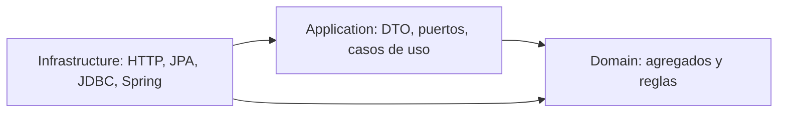

# Arquitectura del backend

## Referencias vigentes y objetivo

El objetivo es el producto completo listo para usar por fases, local primero y servidor después. El plan anterior de demo/50 horas deja de limitar la arquitectura o aceptación. Priorizar [contexto maestro](DEPENDENCY_INTELLIGENCE_CONTEXTO_MAESTRO.md), este documento, [diseño database](CODEX_DATABASE_DEPENDENCY_INTELLIGENCE.md) y [stack](STACK_TECNOLOGICO_DEPENDENCY_INTELLIGENCE.md).

Las decisiones confirmadas incluyen acceso local/Google/GitHub, Maven/npm, equipos/permisos por repositorio y pruebas aisladas/propuesta de PR para el primer piloto. IA del producto: Gemini; embeddings: Ollama. Codex no se integra ni se agenda como proveedor hasta nueva instrucción del usuario.

Los módulos siguientes describen código existente. Database alcanza V13 con 121 tablas, 85 con RLS forzado y 208 FK. Acceso local, organización y autorización en [ACCESO_LOCAL](ACCESO_LOCAL.md). Verificación/recuperación y límites de entrega en [VERIFICACION_Y_RECUPERACION](VERIFICACION_Y_RECUPERACION.md). Estado de base en [implementation-report](database/implementation-report.md).

### Integraciones que se deben separar

- Identidad local y externa detrás de puertos propios: correo/contraseña y vínculos Google/GitHub. La vinculación exige prueba de identidad; no se fusionan cuentas por compartir correo, incluso si está verificado.
- Login GitHub e instalación/autorización para repositorios son flujos de identidad y acceso distintos, aunque una GitHub App puede participar en ambos. Elegir el registro concreto durante implementación; no asumir que hacen falta dos aplicaciones externas.
- Puertos de generación/embeddings: adaptadores Gemini y Ollama en Infrastructure; modelos/dimensión y cuotas comprobados antes de configurar vectores. No son dependencias del dominio ni servicios implementados todavía.
- Almacenamiento privado de originales/artefactos mediante un puerto: descarga/reindexación autorizadas, temporales separados y eliminación/retención configurables. No se elige ni contrata un proveedor de almacenamiento en este bloque.
- Pruebas de cambios en ejecución aislada; propuesta de PR y acciones sobre repositorios sujetas a aprobación explícita en el flujo, sin modificar ramas principales automáticamente.

Referencia sobre identidad e instalaciones: [documentación oficial de GitHub Apps](https://docs.github.com/en/apps/creating-github-apps/about-creating-github-apps/about-creating-github-apps).

El backend es un monolito con tres módulos Maven. Importar `backend/pom.xml` en Java Projects o en el IDE: aparecen **Domain**, **Application** e **Infrastructure**. Las carpetas usan minúsculas por convención; los nombres de proyecto están definidos en cada POM.

```text
backend/
  pom.xml                         # Agregador, sin código ejecutable
  domain/                         # Java puro: entidades, agregados, value objects
    src/main/java/com/dependencyintelligence/<contexto>/domain/
  application/                    # Java puro: orquestación y contratos
    src/main/java/com/dependencyintelligence/<contexto>/application/
      dto/                        # Comandos y resultados de casos de uso
      port/in/                    # Interfaces de entrada
      port/out/                   # Contratos que implementan adaptadores
      usecase/                    # Implementaciones de entrada
      exception/                  # Errores propios de aplicación
  infrastructure/                 # Único módulo ejecutable Spring Boot
    src/main/java/com/dependencyintelligence/
      <contexto>/api/              # Adaptadores HTTP y DTO de transporte
      <contexto>/infrastructure/persistence/
      shared/infrastructure/      # Configuración, transacciones, seguridad, errores HTTP
    src/main/resources/db/migration/
```



Las flechas representan dependencias de código. Domain no depende de frameworks. Application solo depende de Domain. Infrastructure implementa los puertos de salida y configura los casos de uso mediante inyección por constructor. Maven impide importar Infrastructure desde Application o Domain con el classpath actual. Las pruebas ArchUnit verifican además los límites del dominio y de aplicación y la ubicación de controladores y entidades JPA.

Los contextos de negocio (`repository`, `scan`, `organization`, etc.) se conservan dentro de cada capa. `shared` contiene únicamente contratos realmente compartidos. Los `package-info.java` de contextos todavía pendientes no representan funcionalidades implementadas.

## Flujo implementado

1. El controlador convierte el DTO HTTP validado a un comando de Application.
2. `RegisterRepositoryUseCase` verifica que exista la organización, construye el agregado y utiliza `RepositoryStore`.
3. `JpaRepositoryAdapter` transforma entre el dominio y `RepositoryEntity`; la restricción SQL resuelve duplicados incluso con solicitudes concurrentes.
4. `FindRepositoryUseCase` siempre consulta por organización e identificador.
5. `RequestScanUseCase` verifica el repositorio dentro de la organización y persiste un análisis `PENDING` mediante `ScanStore`.

Los DTO no son entidades JPA. `RepositoryId` y `OrganizationId` evitan intercambiar identificadores por accidente. `Scan` protege las transiciones y la cronología mediante operaciones explícitas e inmutables. Las referencias a otros agregados son identificadores; no hay grafos JPA cruzando contextos.

`UseCaseConfiguration` es la raíz de composición. Allí se inyecta `Clock`; `TenantTransactions` delimita lecturas/escrituras y establece `app.organization_id` local a la transacción, sin anotar Application con Spring. JPA y JDBC parametrizado comparten datasource y gestor. Impide cambiar de tenant dentro de una transacción activa y el contexto se limpia por commit/rollback. No se crea una entidad ORM para cada tabla sin un caso de uso que la necesite.

Flyway usa credenciales distintas al datasource `dependency_app`, miembro del capability NOLOGIN `dependency_runtime`. `RuntimeDatabaseRoleGuard` rechaza privilegios de propietario, DDL, mantenimiento o BYPASSRLS. El aprovisionamiento del login es administrativo e idempotente. Las tablas tenant tienen ENABLE/FORCE RLS y FK compuestas; catálogos públicos de lectura y auditoría INSERT/SELECT para runtime. Identidades globales requieren controles de autenticación propios. Las credenciales runtime permiten establecer contexto tenant: el backend debe obtenerlo de una operación autorizada, no confiar en una URL ni exponer SQL arbitrario. Ver [operación de base](database/README.md).

## Seguridad y alcance

### Lectura de SBOM implementada — F03

`SbomParser` es un puerto de salida de Application. `CycloneDxJsonParser`, ubicado en Infrastructure, implementa el subconjunto CycloneDX JSON 1.6/Maven acordado para la demo mediante Jackson, ya incluido por Spring Web. No se ha añadido SDK de scanner ni biblioteca nueva.

El resultado usa DTO propios (`ParsedSbom`, `SbomComponent`) y el value object de Domain `PackageCoordinates`. El paquete/versionado se distingue de la ocurrencia identificada por `bom-ref`: dos referencias distintas pueden apuntar al mismo PURL. El componente raíz de `metadata.component` no se incorpora como biblioteca. No se infieren tipo de dependencia, commit ni hallazgos.

Límites de aplicación: 5 MiB y 500 componentes. El adaptador limita lectura, profundidad JSON, longitud de cadenas y números; rechaza claves JSON repetidas, documentos concatenados, referencias duplicadas —incluida la raíz—, campos obligatorios ausentes, versiones no soportadas y PURL incompatibles con las coordenadas declaradas. Los errores usan razones propias de Application, sin exponer excepciones Jackson como contrato.

Es un parser acotado, no un validador completo del estándar. Por ahora solo admite bibliotecas planas y PURL Maven simples que coincidan literalmente con grupo/nombre/versión; no admite qualifiers, subpaths, coordenadas codificadas ni componentes anidados. No sigue URLs ni ejecuta procesos. El puerto recibe un stream propiedad del llamador y no lo cierra. Ya está conectado al caso de uso de importación persistente F04; la carga HTTP y consulta de inventario siguen pendientes.

Las pruebas focalizadas de este bloque son `CycloneDxJsonParserTest` y `HexagonalArchitectureTest`. No necesitan PostgreSQL ni levantar Spring.

### Importación persistente implementada — F04

`ImportSbom` recibe un comando con organización, repositorio y stream. `ImportSbomUseCase` verifica primero el repositorio dentro de la organización, lee mediante `SbomParser` y calcula SHA-256 sobre los bytes originales con `DigestInputStream`. Solo después de validar llama a `SbomImportStore`. El llamador conserva la propiedad del stream.

`UseCaseConfiguration` envuelve el caso de uso en una transacción. `JdbcSbomImportAdapter` exige esa transacción y guarda snapshot, procedencia, catálogo y ocurrencias mediante JDBC parametrizado. Un error revierte todo el bloque; no deja un snapshot fallido ni componentes parciales. La verificación de organización es de coherencia; la futura entrada HTTP deberá aplicar además los controles de acceso correspondientes.

V3 introdujo namespace, origen y `sbom_imports`; V4–V11 conservan esa información en catálogo normalizado y `sbom_documents`. Una importación crea snapshot `COMPLETED`, origen `SBOM_IMPORT`, trigger `IMPORT`, sin referencia Git ni scanner. Sus tiempos son de importación, no ejecución medida. Los análisis normales conservan origen `REPOSITORY_SCAN` y referencia Git obligatoria; los commits observados tienen entidad propia y FK al repositorio.

El adaptador reutiliza paquete por organización/ecosistema/namespace/nombre y versión exacta por paquete; los PURL se conservan como identificadores alternativos. Usa `ON CONFLICT` y comprueba coordenadas; rechaza incompatibilidades sin sobrescribirlas. Cada importación crea un snapshot y cada `bom-ref` una aparición distinta `UNKNOWN`. No crea aristas, hallazgos ni artefactos ficticios.

`sbom_documents` conserva formato, versión de especificación, serial cuando existe y SHA-256. El importador aún no retiene el original; el esquema admite asociar un artefacto privado cuando se implemente almacenamiento. El hash no reconstruye el archivo. F04 se verifica con ImportSbomUseCaseTest, SbomImportIT y RuntimeDatabaseIT; transición y reglas del modelo mediante DatabaseIT/NormalizedSchemaIT. Resultado y entorno exactos en el informe.

### Acceso a la aplicación

Los adaptadores HTTP de repositorios/scans bajo `/api/organizations/{organizationId}/repositories` exigen sesión y permisos. `AuthorizedRepositoryActions` delimita la transacción tenant y llama al puerto `AuthorizeRepositoryAction` antes del caso de uso. El adaptador JDBC comprueba cuenta/organización/membresía activas, permiso de rol y acceso por equipo. OWNER/ADMIN tienen alcance de organización y MEMBER/VIEWER requieren intersección del permiso del rol con el del equipo para ese repositorio.

`EmailAddress` normaliza el correo en Domain. RegisterAccountUseCase y AuthenticateAccountUseCase dependen de AccountStore/PasswordHashing. JdbcAccountAdapter crea usuario y hash atómicamente. Pbkdf2PasswordAdapter utiliza Spring Security en Infrastructure. AccountController crea el contexto autenticado, rota sesión/CSRF y lo guarda explícitamente en HttpSessionSecurityContextRepository. ActiveAccountFilter consulta la vigencia de la cuenta. AuthenticationRateLimitFilter limita los POST de contraseña por dirección y minuto. Los DTO de credenciales redactan su representación textual y la validación devuelve errores sin valores recibidos.

ManageOrganizationsUseCase crea/lista organizaciones mediante OrganizationStore. Crear incluye membresía OWNER y auditoría en una transacción. Para listar, el adaptador establece `app.user_id` local y V12 permite consultar propias membresías/organizaciones activas. Las sesiones usan cookie HttpOnly/SameSite=Lax con timeout configurable de 30 minutos y se mantienen en memoria. Invitaciones y gestión de equipos siguen pendientes. Contratos en [ACCESO_LOCAL](ACCESO_LOCAL.md).

### Identidades externas — bloque 09

ManageExternalIdentitiesUseCase depende de ExternalIdentityStore y pruebas de identidad propias, sin Spring. Infrastructure adapta Google OIDC/GitHub OAuth mediante spring-boot-starter-oauth2-client y JDBC. TransactionalExternalIdentities serializa cambios con bloqueo de usuario, restricciones únicas y versión de credenciales. Un login reconsulta el vínculo tras bloquear para impedir autenticar con un vínculo retirado concurrentemente.

El inicio requiere POST/CSRF. Authorization requests de un uso ligados a sesión/proveedor, PKCE S256, nonce y plazo configurable. El callback verifica la identidad antes de crear/vincular y guarda SessionIdentity propio con hora de autenticación y versión; los tokens externos se descartan. Vincular exige cuenta verificada y sesión reciente, mantiene la sesión actual y revoca las restantes. Desvincular conserva otro método habilitado e invalida sesiones. URLs fijas derivadas del origen público. Configuración, contratos, alcance de pruebas y activación pendiente con credenciales reales en [IDENTIDAD_GOOGLE_GITHUB](IDENTIDAD_GOOGLE_GITHUB.md). No se modifican V1–V13 ni se implementa instalación GitHub en este bloque.

`PasswordPolicy` comparte la regla de contraseña entre registro y recuperación. `RecoverAccountUseCase` depende de puertos para persistencia, generación/hash de tokens y correo. `TransactionalAccountRecovery` delimita las operaciones desde Infrastructure. El adaptador JDBC bloquea primero el usuario y vuelve a comprobar la vigencia del token. SMTP participa dentro de la transacción de emisión con timeouts para preservar el enlace previo ante un error de envío. La entrega entre SMTP y PostgreSQL tiene los límites descritos en el documento operativo.

`SessionIdentity` conserva usuario y versión de credenciales. AuthenticateAccountUseCase devuelve la versión leída junto al hash validado. El filtro contrasta esa versión en cada petición. Recuperar contraseña sustituye hash, incrementa versión y consume tokens de recuperación/refresh dentro de la transacción. La solicitud pública se acepta en un ejecutor acotado antes de consultar la cuenta. Este ejecutor local reside en memoria. Mailpit recibe el correo de desarrollo y el adaptador JavaMailSender admite SMTP configurable. Los enlaces llegan por fragmento al frontend y requieren confirmación POST con CSRF.

La solicitud de scan se guarda; todavía no existe worker ni integración con scanner, GitHub u OSV. Los contextos restantes conservan sus puntos de extensión. Ver [diseño de base de datos](CODEX_DATABASE_DEPENDENCY_INTELLIGENCE.md) y [estado ejecutable actual](database/implementation-report.md).

## Verificación

Desde `backend/` con JDK 21 y Maven:

```bash
mvn verify
mvn verify -Pdatabase-it
```

El primer comando ejecuta pruebas unitarias y de seguridad y genera `infrastructure/target/infrastructure-0.1.0-SNAPSHOT.jar`. El segundo añade pruebas en PostgreSQL real mediante Testcontainers y requiere Docker. Para usar una base desechable propia, definir `TEST_DATABASE_URL`, `TEST_DATABASE_USER` y `TEST_DATABASE_PASSWORD`; las pruebas crean datos y esquemas, por lo que deben apuntar exclusivamente a una base de prueba.

Para ejecutar el artefacto, aprovisionar el login y configurar credenciales runtime/migración según [database/README.md](database/README.md); usar `java -jar infrastructure/target/infrastructure-0.1.0-SNAPSHOT.jar`. Compose conserva el arranque desde la raíz; volúmenes existentes requieren aprovisionamiento explícito del nuevo login.
