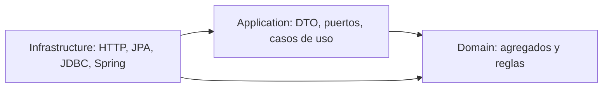

# Arquitectura del backend

El backend es un monolito con tres módulos Maven. Importar `backend/pom.xml` en Java Projects o en el IDE: aparecen **Domain**, **Application** e **Infrastructure**. Las carpetas usan minúsculas por convención; los nombres de proyecto están definidos en cada POM.

```text
backend/
  pom.xml                         # Agregador, sin código ejecutable
  domain/                         # Java puro: entidades, agregados, value objects
    src/main/java/com/dependencyintelligence/<contexto>/domain/
  application/                    # Java puro: orquestación y contratos
    src/main/java/com/dependencyintelligence/<contexto>/application/
      dto/                        # Comandos y resultados de casos de uso
      port/in/                    # Interfaces de entrada
      port/out/                   # Contratos que implementan adaptadores
      usecase/                    # Implementaciones de entrada
      exception/                  # Errores propios de aplicación
  infrastructure/                 # Único módulo ejecutable Spring Boot
    src/main/java/com/dependencyintelligence/
      <contexto>/api/              # Adaptadores HTTP y DTO de transporte
      <contexto>/infrastructure/persistence/
      shared/infrastructure/      # Configuración, transacciones, seguridad, errores HTTP
    src/main/resources/db/migration/
```



Las flechas representan dependencias de código. Domain no depende de frameworks. Application solo depende de Domain. Infrastructure implementa los puertos de salida y configura los casos de uso mediante inyección por constructor. Maven impide importar Infrastructure desde Application o Domain con el classpath actual. Las pruebas ArchUnit verifican además los límites del dominio y de aplicación y la ubicación de controladores y entidades JPA.

Los contextos de negocio (`repository`, `scan`, `organization`, etc.) se conservan dentro de cada capa. `shared` contiene únicamente contratos realmente compartidos. Los `package-info.java` de contextos todavía pendientes no representan funcionalidades implementadas.

## Flujo implementado

1. El controlador convierte el DTO HTTP validado a un comando de Application.
2. `RegisterRepositoryUseCase` verifica que exista la organización, construye el agregado y utiliza `RepositoryStore`.
3. `JpaRepositoryAdapter` transforma entre el dominio y `RepositoryEntity`; la restricción SQL resuelve duplicados incluso con solicitudes concurrentes.
4. `FindRepositoryUseCase` siempre consulta por organización e identificador.
5. `RequestScanUseCase` verifica el repositorio dentro de la organización y persiste un análisis `PENDING` mediante `ScanStore`.

Los DTO no son entidades JPA. `RepositoryId` y `OrganizationId` evitan intercambiar identificadores por accidente. `Scan` protege las transiciones y la cronología mediante operaciones explícitas e inmutables. Las referencias a otros agregados son identificadores; no hay grafos JPA cruzando contextos.

`UseCaseConfiguration` es la raíz de composición. Allí se inyecta `Clock` y se delimitan las transacciones de escritura con `TransactionTemplate`, sin anotar Application con Spring. Repositorios usan JPA; consultas de existencia y escritura de scans usan JDBC parametrizado con el mismo datasource y gestor transaccional. No se crea una entidad ORM para cada tabla sin un caso de uso que la necesite.

## Seguridad y alcance

Los adaptadores HTTP de repositorios y scans existen bajo `/api/organizations/{organizationId}/repositories`, pero la política actual deniega todos los endpoints de negocio. Solo health es público. Un ID recibido en una ruta **no autoriza** al usuario: antes de habilitar estas rutas deben implementarse identidad, validación de membresía y permisos. Los filtros y claves compuestas protegen la coherencia de relaciones, pero no sustituyen autorización ni implementan RLS.

La solicitud de scan se guarda; todavía no existe worker ni integración con scanner, GitHub u OSV. Los contextos restantes conservan sus puntos de extensión. Ver [BASE_DE_DATOS.md](BASE_DE_DATOS.md) para el esquema y las pruebas.

## Verificación

Desde `backend/` con JDK 21 y Maven:

```bash
mvn verify
mvn verify -Pdatabase-it
```

El primer comando ejecuta pruebas unitarias y de seguridad y genera `infrastructure/target/infrastructure-0.1.0-SNAPSHOT.jar`. El segundo añade pruebas en PostgreSQL real mediante Testcontainers y requiere Docker. Para usar una base desechable propia, definir `TEST_DATABASE_URL`, `TEST_DATABASE_USER` y `TEST_DATABASE_PASSWORD`; las pruebas crean datos y esquemas, por lo que deben apuntar exclusivamente a una base de prueba.

Para ejecutar el artefacto, configurar `POSTGRES_PASSWORD`, `DB_HOST`, `DB_PORT`, `POSTGRES_DB` y `POSTGRES_USER` según `application.yml` y usar `java -jar infrastructure/target/infrastructure-0.1.0-SNAPSHOT.jar`. Compose conserva el arranque de la aplicación completa desde la raíz.
