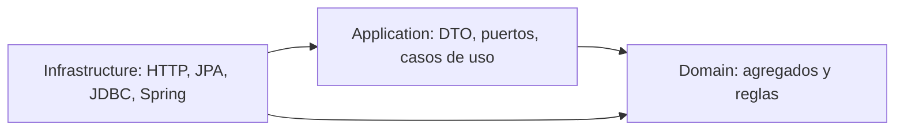

# Arquitectura del backend

## Referencias vigentes y objetivo

El objetivo es el producto completo listo para usar por fases, local primero y servidor después. El plan anterior de demo/50 horas deja de limitar la arquitectura o aceptación. Priorizar [contexto maestro](DEPENDENCY_INTELLIGENCE_CONTEXTO_MAESTRO.md), este documento, [diseño database](CODEX_DATABASE_DEPENDENCY_INTELLIGENCE.md) y [stack](STACK_TECNOLOGICO_DEPENDENCY_INTELLIGENCE.md).

Las decisiones confirmadas incluyen acceso local/Google/GitHub, Maven/npm, equipos/permisos por repositorio y pruebas aisladas/propuesta de PR para el primer piloto. IA del producto: Gemini; embeddings: Ollama. Codex no se integra ni se agenda como proveedor hasta nueva instrucción del usuario.

Los módulos siguientes describen código existente. La nueva especificación database aún requiere migraciones y adaptación de los casos de uso: paquete/versión/presencia separados, RBAC/equipos, jobs, RLS y módulos posteriores. No se declara implementado por estar descrito en documentos. Ver [estado real](database/implementation-report.md).

### Integraciones que se deben separar

- Identidad local y externa detrás de puertos propios: correo/contraseña y vínculos Google/GitHub. La vinculación exige prueba de identidad; no se fusionan cuentas únicamente por compartir un correo no verificado.
- Login GitHub e instalación/autorización para repositorios son flujos de identidad y acceso distintos, aunque una GitHub App puede participar en ambos. Elegir el registro concreto durante implementación; no asumir que hacen falta dos aplicaciones externas.
- Puertos de generación/embeddings: adaptadores Gemini y Ollama en Infrastructure; modelos/dimensión y cuotas comprobados antes de configurar vectores. No son dependencias del dominio ni servicios implementados todavía.
- Almacenamiento privado de originales/artefactos mediante un puerto: descarga/reindexación autorizadas, temporales separados y eliminación/retención configurables. No se elige ni contrata un proveedor de almacenamiento en este bloque.
- Pruebas de cambios en ejecución aislada; propuesta de PR y acciones sobre repositorios sujetas a aprobación explícita en el flujo, sin modificar ramas principales automáticamente.

Referencia sobre identidad e instalaciones: [documentación oficial de GitHub Apps](https://docs.github.com/en/apps/creating-github-apps/about-creating-github-apps/about-creating-github-apps).

El backend es un monolito con tres módulos Maven. Importar `backend/pom.xml` en Java Projects o en el IDE: aparecen **Domain**, **Application** e **Infrastructure**. Las carpetas usan minúsculas por convención; los nombres de proyecto están definidos en cada POM.

```text
backend/
  pom.xml                         # Agregador, sin código ejecutable
  domain/                         # Java puro: entidades, agregados, value objects
    src/main/java/com/dependencyintelligence/<contexto>/domain/
  application/                    # Java puro: orquestación y contratos
    src/main/java/com/dependencyintelligence/<contexto>/application/
      dto/                        # Comandos y resultados de casos de uso
      port/in/                    # Interfaces de entrada
      port/out/                   # Contratos que implementan adaptadores
      usecase/                    # Implementaciones de entrada
      exception/                  # Errores propios de aplicación
  infrastructure/                 # Único módulo ejecutable Spring Boot
    src/main/java/com/dependencyintelligence/
      <contexto>/api/              # Adaptadores HTTP y DTO de transporte
      <contexto>/infrastructure/persistence/
      shared/infrastructure/      # Configuración, transacciones, seguridad, errores HTTP
    src/main/resources/db/migration/
```



Las flechas representan dependencias de código. Domain no depende de frameworks. Application solo depende de Domain. Infrastructure implementa los puertos de salida y configura los casos de uso mediante inyección por constructor. Maven impide importar Infrastructure desde Application o Domain con el classpath actual. Las pruebas ArchUnit verifican además los límites del dominio y de aplicación y la ubicación de controladores y entidades JPA.

Los contextos de negocio (`repository`, `scan`, `organization`, etc.) se conservan dentro de cada capa. `shared` contiene únicamente contratos realmente compartidos. Los `package-info.java` de contextos todavía pendientes no representan funcionalidades implementadas.

## Flujo implementado

1. El controlador convierte el DTO HTTP validado a un comando de Application.
2. `RegisterRepositoryUseCase` verifica que exista la organización, construye el agregado y utiliza `RepositoryStore`.
3. `JpaRepositoryAdapter` transforma entre el dominio y `RepositoryEntity`; la restricción SQL resuelve duplicados incluso con solicitudes concurrentes.
4. `FindRepositoryUseCase` siempre consulta por organización e identificador.
5. `RequestScanUseCase` verifica el repositorio dentro de la organización y persiste un análisis `PENDING` mediante `ScanStore`.

Los DTO no son entidades JPA. `RepositoryId` y `OrganizationId` evitan intercambiar identificadores por accidente. `Scan` protege las transiciones y la cronología mediante operaciones explícitas e inmutables. Las referencias a otros agregados son identificadores; no hay grafos JPA cruzando contextos.

`UseCaseConfiguration` es la raíz de composición. Allí se inyecta `Clock` y se delimitan las transacciones de escritura con `TransactionTemplate`, sin anotar Application con Spring. Repositorios usan JPA; consultas de existencia y escritura de scans usan JDBC parametrizado con el mismo datasource y gestor transaccional. No se crea una entidad ORM para cada tabla sin un caso de uso que la necesite.

## Seguridad y alcance

### Lectura de SBOM implementada — F03

`SbomParser` es un puerto de salida de Application. `CycloneDxJsonParser`, ubicado en Infrastructure, implementa el subconjunto CycloneDX JSON 1.6/Maven acordado para la demo mediante Jackson, ya incluido por Spring Web. No se ha añadido SDK de scanner ni biblioteca nueva.

El resultado usa DTO propios (`ParsedSbom`, `SbomComponent`) y el value object de Domain `PackageCoordinates`. El paquete/versionado se distingue de la ocurrencia identificada por `bom-ref`: dos referencias distintas pueden apuntar al mismo PURL. El componente raíz de `metadata.component` no se incorpora como biblioteca. No se infieren tipo de dependencia, commit ni hallazgos.

Límites de aplicación: 5 MiB y 500 componentes. El adaptador limita lectura, profundidad JSON, longitud de cadenas y números; rechaza claves JSON repetidas, documentos concatenados, referencias duplicadas —incluida la raíz—, campos obligatorios ausentes, versiones no soportadas y PURL incompatibles con las coordenadas declaradas. Los errores usan razones propias de Application, sin exponer excepciones Jackson como contrato.

Es un parser acotado, no un validador completo del estándar. Por ahora solo admite bibliotecas planas y PURL Maven simples que coincidan literalmente con grupo/nombre/versión; no admite qualifiers, subpaths, coordenadas codificadas ni componentes anidados. No sigue URLs ni ejecuta procesos. El puerto recibe un stream propiedad del llamador y no lo cierra. Ya está conectado al caso de uso de importación persistente F04; la carga HTTP y consulta de inventario siguen pendientes.

Las pruebas focalizadas de este bloque son `CycloneDxJsonParserTest` y `HexagonalArchitectureTest`. No necesitan PostgreSQL ni levantar Spring.

### Importación persistente implementada — F04

`ImportSbom` recibe un comando con organización, repositorio y stream. `ImportSbomUseCase` verifica primero el repositorio dentro de la organización, lee mediante `SbomParser` y calcula SHA-256 sobre los bytes originales con `DigestInputStream`. Solo después de validar llama a `SbomImportStore`. El llamador conserva la propiedad del stream.

`UseCaseConfiguration` envuelve el caso de uso en una transacción. `JdbcSbomImportAdapter` exige esa transacción y guarda snapshot, procedencia, catálogo y ocurrencias mediante JDBC parametrizado. Un error revierte todo el bloque; no deja un snapshot fallido ni componentes parciales. La verificación de organización es de coherencia; la futura entrada HTTP deberá aplicar además los controles de acceso correspondientes.

V3 añade namespace al catálogo, origen del snapshot y tabla `sbom_imports`. Un snapshot de importación se crea `COMPLETED`, con origen `SBOM_IMPORT`, referencia Git y metadatos de scanner ausentes. Sus tiempos representan el instante de importación, no una ejecución medida de scanner. Los análisis normales conservan origen `REPOSITORY_SCAN` y referencia Git obligatoria.

El adaptador reutiliza el catálogo por organización/PURL mediante `ON CONFLICT`, conservando namespace, nombre, versión y ecosistema. Si las coordenadas registradas son incompatibles, rechaza la importación en lugar de sobrescribirlas. Cada importación aceptada crea un snapshot nuevo y cada `bom-ref` conserva su propia ocurrencia, clasificada `UNKNOWN`. No crea aristas, hallazgos ni artefactos con rutas ficticias.

`sbom_imports` conserva formato, versión de especificación, serial cuando existe y SHA-256 del documento. No se conserva el archivo original; el hash permite identificar bytes, no reconstruirlos ni sustituir su almacenamiento. F04 se verifica con `ImportSbomUseCaseTest`, `SbomImportIT`, pruebas afectadas de `ScanTest` y comprobaciones de migración/arquitectura.

### Acceso a la aplicación

Los adaptadores HTTP de repositorios y scans existen bajo `/api/organizations/{organizationId}/repositories`, pero la política actual deniega todos los endpoints de negocio. Solo health es público. Un ID recibido en una ruta **no autoriza** al usuario: antes de habilitar estas rutas deben implementarse identidad, validación de membresía y permisos. Los filtros y claves compuestas protegen la coherencia de relaciones, pero no sustituyen autorización ni implementan RLS.

La solicitud de scan se guarda; todavía no existe worker ni integración con scanner, GitHub u OSV. Los contextos restantes conservan sus puntos de extensión. Ver [diseño de base de datos](CODEX_DATABASE_DEPENDENCY_INTELLIGENCE.md) y [estado ejecutable actual](database/implementation-report.md).

## Verificación

Desde `backend/` con JDK 21 y Maven:

```bash
mvn verify
mvn verify -Pdatabase-it
```

El primer comando ejecuta pruebas unitarias y de seguridad y genera `infrastructure/target/infrastructure-0.1.0-SNAPSHOT.jar`. El segundo añade pruebas en PostgreSQL real mediante Testcontainers y requiere Docker. Para usar una base desechable propia, definir `TEST_DATABASE_URL`, `TEST_DATABASE_USER` y `TEST_DATABASE_PASSWORD`; las pruebas crean datos y esquemas, por lo que deben apuntar exclusivamente a una base de prueba.

Para ejecutar el artefacto, configurar `POSTGRES_PASSWORD`, `DB_HOST`, `DB_PORT`, `POSTGRES_DB` y `POSTGRES_USER` según `application.yml` y usar `java -jar infrastructure/target/infrastructure-0.1.0-SNAPSHOT.jar`. Compose conserva el arranque de la aplicación completa desde la raíz.
