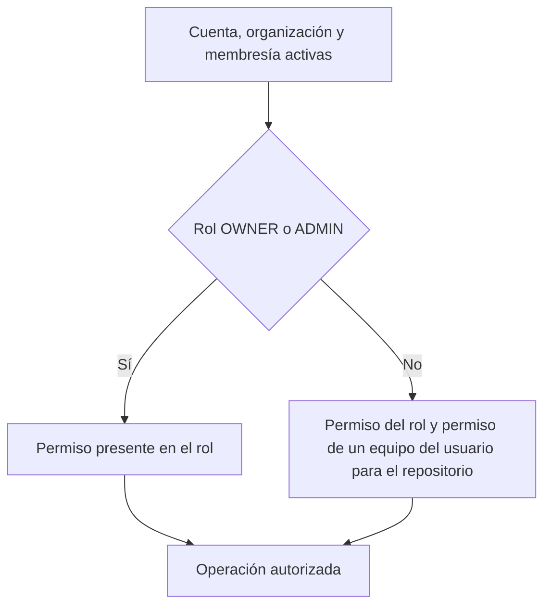

# Invitaciones, equipos y permisos

Bloque 11, 15 de noviembre de 2026. Implementación solicitada explícitamente por el usuario. Backend y Angular disponibles; revisión visual conjunta y arranque Compose pendientes. No se activan Google/GitHub ni otros módulos con este trabajo.

## Recorrido local para revisar

Actualización visual del bloque 13: entrar en **Organización** desde la barra lateral, seleccionar el espacio y usar **Miembros**, **Invitaciones**, **Equipos** o **Permisos**. **Invitar miembro** abre el formulario de correo/rol. La tabla de miembros permite buscar, filtrar por estado y editar acceso desde su acción. Son las mismas APIs/reglas descritas abajo; el dashboard y login/registro también se rediseñaron según las imágenes del usuario. [Referencia visual vigente](DISENO_FRONTEND.md).

1. Levantar el entorno siguiendo [README](../README.md). Con Compose, abrir `http://localhost:8088` y Mailpit en `http://localhost:8025`. El correo local termina en Mailpit; no se envía a bandejas externas.
2. Crear/iniciar una cuenta, crear una organización y pulsar **Miembros y equipos**. La persona creadora tiene OWNER.
3. Introducir el correo de otra persona y elegir rol. **Enviar invitación** entrega un enlace por SMTP. La lista muestra estado y caducidad; una invitación pendiente puede revocarse. Para reenviar, revocar y crear otra, invalidando el enlace anterior.
4. En otra sesión del navegador, abrir el enlace de Mailpit. Crear/iniciar sesión con el correo invitado, verificarlo mediante el flujo existente y pulsar **Aceptar invitación**. La organización aparece en la lista tras aceptar. Si se cambia de pestaña para verificar o se usa OAuth, volver a abrir el enlace de invitación después; el token solo se conserva en memoria, sin localStorage/sessionStorage.
5. Desde la cuenta gestora, asignar roles/estados con confirmación, crear/renombrar/eliminar equipos y marcar miembros. Eliminar equipo exige confirmación y retira sus permisos/asociaciones; conserva las cuentas y membresías de la organización.
6. Seleccionar un repositorio habilitado del equipo, elegir permisos y guardar. Guardar sin permisos retira el acceso de ese equipo. Actualmente los repositorios se registran por la API existente; falta la pantalla de conexión/registro. No se añaden repositorios de demostración al producto.

## Política de gestión

| Acción | OWNER | ADMIN | MEMBER / VIEWER |
| --- | --- | --- | --- |
| Consultar panel de miembros, invitaciones y equipos | Sí | Sí | No |
| Invitar/asignar MEMBER o VIEWER | Sí | Sí | No |
| Invitar/asignar OWNER o ADMIN | Sí | No | No |
| Modificar o suspender una membresía OWNER/ADMIN | Sí, conservando un propietario activo | No | No |
| Crear, renombrar, eliminar equipos y gestionar sus miembros/permisos | Sí | Sí | No |
| Aceptar invitación | Cuenta activa, correo coincidente/verificado y token válido | Igual | Igual |

Se mantiene el catálogo predefinido OWNER/ADMIN/MEMBER/VIEWER. Cada operación de asignación reemplaza los roles de la membresía por un rol elegido; no se implementan roles personalizados. El panel muestra los permisos actuales del catálogo y no permite editarlo.

Cambiar a `SUSPENDED` conserva las asociaciones a equipos, pero el usuario pierde acceso por su estado. Reactivar recupera esas asociaciones. Cambiar a `LEFT` las elimina. Una nueva invitación aceptada para una membresía inactiva la reactiva con el nuevo rol y sin heredar equipos anteriores.

Solo se añaden a equipos miembros activos de la misma organización. No se puede suspender, retirar ni degradar al último propietario activo. Las comprobaciones y escrituras comparten transacción tenant y bloqueo de la organización, protegiendo también cambios simultáneos. La revocación se refleja en las siguientes operaciones autorizadas; no cancela retroactivamente una operación ya autorizada/en curso. [Bloqueos de PostgreSQL](https://www.postgresql.org/docs/18/explicit-locking.html).

## Permisos efectivos de repositorio

El equipo limita el alcance del rol; no lo amplía. Un VIEWER con `scan.create` asignado por equipo sigue sin poder solicitar análisis. Para MEMBER/VIEWER, quitar un equipo o sus permisos retira el acceso cuando no existe otro equipo que lo conceda.

El editor admite `repository.read`, `repository.manage`, `scan.read`, `scan.create`, `document.read`, `document.manage`, `assistant.query`, `impact.create`, `change.simulate`, `change.propose`, `report.read` y `report.export`. Un OWNER puede dar `repository.manage` a un equipo para un solo repositorio; un MEMBER de ese equipo puede gestionar esa conexión únicamente cuando la autorización incluye el ID de ese repositorio. Las operaciones a nivel organización con repositorio nulo siguen reservadas a OWNER/ADMIN. `ADMIN` continúa siendo administrador de toda la organización. Los permisos de módulos futuros son configuración; no convierten esos módulos en funciones implementadas.

## Seguridad y entrega de invitaciones

- Token aleatorio de 32 bytes codificado en Base64 URL-safe; PostgreSQL almacena solo SHA-256. El enlace lleva organización/ID/token en fragmento; el frontend valida su forma y lo retira de la URL. No se devuelve token ni hash en los DTO de lista/creación.
- GET no acepta la invitación. El POST exige sesión, CSRF, cuenta activa, correo normalizado coincidente y verificado. La comparación del hash es constante mediante MessageDigest. Caducidad y estado se comprueban dentro del bloqueo; dos aceptaciones simultáneas producen un único ganador.
- Se revalida que quien invitó conserve una membresía activa y autorización para conceder ese rol. Degradar/suspender a esa persona impide aceptar una invitación que ya no pueda conceder; otro gestor debe revocarla y emitir una nueva.
- Solo hay una invitación pendiente por correo y organización. La caducidad se muestra calculada al consultar y la fila pendiente caducada se marca EXPIRED al emitir una sustituta; no hay un job periódico de expiración.
- El envío SMTP es síncrono con los timeouts existentes de tres segundos y forma parte de la transacción de emisión. Un fallo de envío revierte invitación/roles/auditoría. Si SMTP acepta y luego falla el commit, puede llegar un enlace inválido; el gestor debe volver a enviar una invitación. La entrega durable/outbox y reintentos quedan en pendientes para servidor.
- Inicio/aceptación/revocación de invitaciones participan en el presupuesto de intentos por dirección/proceso, junto con autenticación. El límite sigue requiriendo coordinación/proxy de confianza en servidor.
- Creación, aceptación y revocación de invitaciones; cambios de membresías, equipos y permisos generan auditoría en la misma transacción, sin secretos. No se borra la auditoría al eliminar un equipo.

## Contratos HTTP

Todas las rutas llevan prefijo `/api/organizations/{organizationId}`, requieren sesión y los POST exigen CSRF. IDs se validan como UUID. Listado/gestión exigen gestor activo; aceptación permite a la cuenta invitada entrar sin membresía previa.

| Método y ruta relativa | Cuerpo / resultado |
| --- | --- |
| `GET /access` | Membresía propia, miembros, equipos/asociaciones, repositorios habilitados, catálogo y últimas 100 invitaciones; sin tokens |
| `POST /invitations` | `{email, role, teamId, repositoryId}` → 201, resumen; SMTP. Para administración de un solo repositorio, invitar como MEMBER y después conceder `repository.manage` a su equipo/repositorio. |
| `POST /invitations/{invitationId}/revoke` | `{}` → 204, cualquier OWNER activo puede revocarla mientras siga pendiente |
| `POST /invitations/{invitationId}/accept` | `{token}` → 204, membresía con rol y consumo atómicos |
| `POST /members/{membershipId}` | `{role, status}` → 204; status ACTIVE/SUSPENDED/LEFT |
| `POST /teams` | `{name}` → 201, `{id}` |
| `POST /teams/{teamId}` | `{name}` → 204 |
| `POST /teams/{teamId}/delete` | `{}` → 204, elimina asociaciones/permisos |
| `POST /teams/{teamId}/members/{membershipId}` | `{included: true/false}` → 204 |
| `POST /teams/{teamId}/repositories/{repositoryId}/permissions` | `{permissions: [...]}` → 204, sustituye el conjunto del equipo/repositorio |
| `POST /members/{membershipId}/repositories/{repositoryId}/permissions` | `{permissions: [...]}` → 204, sustituye grants directos de esa persona y repositorio; intersección con los permisos del rol |

400 para formato/rol/permiso inválido, 401 sin sesión, 403 sin autorización/CSRF, 404 para recursos ajenos o inexistentes dentro del tenant autorizado, 409 para conflicto de estado/último propietario/invitación inválida y 503 ante fallo SMTP. La API no incluye cuerpos recibidos ni tokens en errores.

Configuración nueva: `INVITATION_LIFETIME=PT72H`, duración ISO-8601 positiva. Es el valor inicial configurable, no una estimación de trabajo. Se reutilizan `PUBLIC_BASE_URL`, `MAIL_FROM`, SMTP y el límite de intentos existentes. No almacenar secretos en documentos.

## Arquitectura, base y comprobaciones

Domain añade OrganizationRole. Application contiene ManageInvitations/ManageOrganizationAccess, reglas, DTO y puertos de persistencia/entrega; no importa Spring/JPA. Infrastructure configura transacciones tenant, adaptadores JDBC, controladores y JavaMailSender. No se añadió ninguna dependencia del producto. Se reutilizan tablas de V5, versión V13 y permisos runtime existentes: **121 tablas, 85 con FORCE RLS y 208 FK**, sin migración nueva ni cambios de diagramas.

Ocho pruebas nuevas de OrganizationAccessIT correctas con PostgreSQL nativo y SMTP Mailpit real: correo y hash, destinatario/verificación, expiración/revocación/replay, colisiones, roles/último propietario, concurrencia de aceptación/democión, aislamiento tenant/CSRF, permisos efectivos de repositorio, vuelta a la organización y rollback ante fallo SMTP. Cinco de LocalAccessIT y ocho de seguridad/arquitectura/límite correctas: 21 casos distintos pertinentes en el bloque. Cinco aserciones del parser de invitaciones correctas.

Build Angular correcto. La primera construcción superó el presupuesto inicial de 500 kB al cargar todos los controles. Se separaron pantallas con `@defer`, estados de carga/error y gestión bajo selección de organización; resultado inicial 381,28 kB, sin ampliar el presupuesto. [Carga diferida de Angular](https://angular.dev/guide/templates/defer).

## Límites y trabajo posterior

Queda revisión visual conjunta de este recorrido y arranque Compose. Se muestran las últimas 100 invitaciones; completar paginación de historiales grandes cuando corresponda. La entrega durable SMTP y las sesiones persistentes siguen pendientes para servidor. No se probó SMTP externo ni consentimiento real de Google/GitHub en este bloque.

El usuario puede revisar miembros/equipos con Mailpit al levantar el entorno. El hito de análisis de repositorios reales continúa pendiente. Consultar [PENDIENTES](PENDIENTES.md) antes de elegir el siguiente bloque con el usuario; no empezar automáticamente GitHub ni otros módulos.
